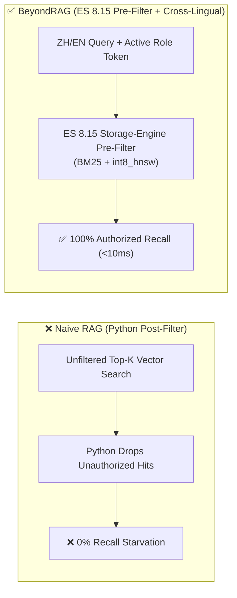

# BeyondRAG — Enterprise RAG Sandbox, Beyond the Demo

> **Series:** *Beyond a PoC*. Each episode takes a problem that RAG tutorials skip, builds it into this codebase, and tests it.

Most RAG tutorials stop at chunking a single PDF for a single user. A company-wide knowledge base has to control who sees what, and it has to stay correct while documents are messy, keep changing and can be legally required to disappear.

| Episode | Focus | What it adds |
| :--- | :--- | :--- |
| [**#01**](#episode-1--access-management--cross-language-retrieval) | Access management and cross-language retrieval | Role pre-filtering inside Elasticsearch 8.15, and Chinese queries against English documents |
| [**#02**](#episode-2--production-document-ingestion) | Production document ingestion | Complex formats, multilingual processing, semantic chunking, versioning and ground-truth decay, GDPR deletion, continuous evaluation |
| [**#03**](#episode-3--retrieval-at-scale) | Retrieval at scale | Vector quantization, hybrid search with RRF, query transformation, parent-child chunks, cross-encoder re-ranking, multi-hop retrieval, context reordering |
| [**#04**](#episode-4--trustworthy-answers) | Trustworthy answers | Per-sentence citations, hallucination checks, a measured LLM checker, abstention, a trust report per answer |

---

## Quickstart

```bash
git clone https://github.com/metemertkan/BeyondRAG.git
cd BeyondRAG
docker compose up -d --build
```

Open **`http://localhost:8090`**:

1. **Left panel (`1. Document Upload & Knowledge Base`):**
   - Upload a `.pdf`, `.md`, `.txt` or `.xlsx` file and assign role tags (`finance`, `operation`), or leave it untagged (`PUBLIC`).
   - See every indexed document, including superseded versions, and its live `✓ Unlocked` / `🔒 Locked` state as you switch roles in the top bar.
2. **Right panel (`2. Multi-Lingual RBAC Chat`):**
   - Click a pre-generated query (`[Public]`, `[Finance]`, `[Operation]`) while switching between `Public Only`, `Finance Role`, `Operation Role` and `All Roles`.

LLM features use Gemini when `GOOGLE_API_KEY` is set, and local Ollama otherwise. Copy `.env.example` to `.env` to configure them.

---

## Episode 1 — Access Management & Cross-Language Retrieval

Two production challenges break naive RAG pipelines as soon as a knowledge base is shared across a company:

1. **Access management (RBAC pre-filtering):** Documents uploaded by different departments carry role tags (`finance`, `operation`, or untagged `PUBLIC`). Filtering permissions in Python *after* an unfiltered `top-K` vector search causes **0% recall starvation** whenever restricted chunks saturate the `top-K` HNSW candidate slots. BeyondRAG pushes `terms` pre-filters directly into **Elasticsearch 8.15**, across both BM25 and `int8_hnsw` kNN.
2. **Cross-language (`ZH ↔ EN`) retrieval:** Policies are often written in **English**, while teams query them in **Chinese** (for example, asking `「最低港元現金儲備緩衝是多少？」` against an English Treasury PDF). BeyondRAG aligns bilingual domain concepts in a shared vector space while enforcing RBAC boundaries.

### Naive post-filtering vs. BeyondRAG



### Reproduce the benchmark

Run the standalone Elasticsearch 8.15 benchmark inside the container:

```bash
docker compose exec beyondrag-app python benchmark_rbac.py
```

| Retrieval Strategy | Authorized Recall | P95 Latency | Behavior |
| :--- | :---: | :---: | :--- |
| **Query 1: Unfiltered Top-5 kNN + Python Post-Filter** | `0 / 2` (**0%**) | N/A | Restricted chunks fill all 5 HNSW slots; Python drops all 5 hits. |
| **Query 2: ES 8.15 Pre-Filtered Hybrid (`BM25 + int8_hnsw`)** | `2 / 2` (**100%**) | **`~3–7 ms`** | Pushes `terms: {"acl_tags": ["__public__", ...roles]}` into the storage engine. |

---

## Episode 2 — Production Document Ingestion

Getting a clean demo out of a RAG pipeline is easy. Keeping it correct when the data is messy, changing and legally constrained is the hard part. Episode 2 covers six challenges, each implemented here and tested in [`tests/test_ingestion_challenges.py`](./tests/test_ingestion_challenges.py). [`WHAT_SHIPPED.md`](./WHAT_SHIPPED.md) maps each claim to its code and tests.

| Challenge | Failure without it | What the code does | Where |
| --- | --- | --- | --- |
| **Complex formats** | Flat ETL loses table structure, formula results and merged cells | PDF tables and Excel become Markdown tables; merged cells fill every row; formulas index their calculated result; cross-sheet references get a lineage note; hidden sheets are skipped; large sheets become one summary chunk plus a SQLite table queried by a structured tool call | `extractor.py`, `tabular_store.py` |
| **Multilingual** | Reversed Arabic, oversized Chinese chunks, zero-information vectors | RTL reading-order repair, tashkeel and presentation-form normalization, jieba segmentation, script-aware sentence splitting, an ES analyzer with Arabic normalization and Han bigrams, a PaddleOCR adapter for scanned pages, `bge-m3` as the shared embedding space | `multilingual.py`, `ocr.py`, `es_client.py` |
| **Semantic chunking** | Fixed windows cut across topics; pure semantic chunking is slow and fragments long sections | Topic boundaries from sentence-embedding similarity, 15% sliding overlap, minimum and maximum chunk size, and a router that sends uniform documents to cheap fixed-size chunking | `chunker.py` |
| **Versioning and ground-truth decay** | Old and new facts compete; the LLM blends them | Soft `SUPERSEDED` versions, expiry dates, trust tiers that re-rank results, numeric conflict detection, and a precedence prompt that makes the model declare contradictions | `ingestor.py`, `governance.py`, `retriever.py`, `synthesizer.py` |
| **GDPR and deletions** | Deleting a file leaves chunks, old versions, vectors, tables and derived concepts behind | `source_key` and `subject_ids` lineage on every chunk, dry-run plans, purge of every store, re-scan verification, tombstones against re-sync resurrection, keyed-hash audit log, source-system delete and archive events | `erasure.py`, `repository.py` |
| **Continuous evaluation** | Retrieval quality degrades silently | A golden dataset, run on demand and scored by a local LLM judge on Context Precision and Faithfulness, plus deterministic checks that retired facts stay out of the context | `src/eval/`, `.github/workflows/rag-eval.yml` |

### Try it

```bash
# Upload with governance and lineage metadata
curl -F file=@tests/fixtures/xlsx/regional_budget.xlsx -F tags=finance \
     -F trust_tier=official_policy -F effective_date=2026-01-05 \
     http://localhost:8090/api/upload

# Right-to-be-forgotten: dry run by default. Requires RAG_GOVERNANCE_TOKEN in .env.
curl -X POST http://localhost:8090/api/erasure \
     -H "X-Governance-Token: $RAG_GOVERNANCE_TOKEN" -H "Content-Type: application/json" \
     -d '{"subject_id": "maya.chen@example.com"}'
```

Regenerate the measurements behind the episode visuals with `python scripts/ep2_showcase.py --out showcase.json`.

### Continuous evaluation

This is a demonstration gate: the judge is local Ollama (`qwen3:8b`), which can misjudge an answer and is slow on CPU. The floors live in [`eval/golden_dataset.json`](./eval/golden_dataset.json).

```bash
pip install -e ".[dev]"
python scripts/run_eval.py                               # exit 0 passed, 1 gate failed, 2 inconclusive
python scripts/run_eval.py --simulate-drift stale_index  # see the gate catch a regression
RAG_EVAL_OLLAMA_MODEL=<installed model> python scripts/run_eval.py  # use a different judge
```

One local run, with `feature_hash` embeddings on Elasticsearch:

| Run | Result | Context precision (floor 0.70) | Faithfulness (floor 0.80) | Answer correct (floor 0.75) | Retired-fact leaks (max 0) |
| :--- | :--- | :---: | :---: | :---: | :---: |
| Clean | Passed | 0.958 | 0.863 | 1.000 | 0 |
| Simulated `stale_index` | Failed, as intended | 0.875 | 0.863 | 0.875 | 2 |

An unavailable judge or missing model exits 2, because a gate that passes without evaluating anything is worse than no gate.

[`.github/workflows/rag-eval.yml`](./.github/workflows/rag-eval.yml) runs the same gate when started by hand from `main`. It needs a self-hosted runner on a machine with uv, Ollama and Elasticsearch, and does not run on merges, so it cannot block a regression. To block merges, also trigger it on `pull_request` and mark the check as required, after reviewing the risk of self-hosted runners on a public repository.

### Limits worth knowing

- **Deletion is two-phase.** Search stops returning erased data immediately, but Elasticsearch keeps deleted text in its segments under a retention lease, so a force-merge straight after the delete removes nothing. `confirm_physical_purge` retries and writes the outcome to the audit log. On the single-node sandbox this takes about 30 seconds; replicas can hold a lease for longer.
- **Backups are out of scope.** Snapshots keep erased data until they expire under their own retention window. Every receipt says so.
- **Subject detection finds emails only.** Names and employee IDs must be declared through `subject_ids`. Verification also runs a full-text scan for the identifier, which catches mentions that lineage missed.
- **Keeping a document that names someone** (`include_detected: false`) produces an incomplete receipt until that file is redacted or removed.
- **Conflict detection is a numeric heuristic.** It compares values such as amounts and durations across sources on the same topic. Contradictions in wording alone rely on the LLM prompt rules.
- **OCR is per page and per language.** PaddleOCR's Arabic recognizer read our test scan's Arabic text and numbers correctly but turned `HKD` into `H`. Mixed-script scans still need review; see `tests/fixtures/README.md`. It is an optional install: `pip install .[ocr]`.
- **`feature_hash` is not semantic.** It keeps CI deterministic. Use `RAG_EMBEDDING_PROVIDER=ollama` with `bge-m3` (`RAG_EMBEDDING_DIMS=1024`) for cross-language retrieval and meaningful topic boundaries.
- **The judge is a model too.** In a local run, `qwen3:8b` scored one correct answer 0.40 on faithfulness because it listed claims from a source instead of from the answer. Clean faithfulness also moved between runs with the same judge (0.925 and 0.863). That is why the gate uses averages over a dataset and keeps deterministic checks beside the judged scores. A larger golden set and a stronger judge reduce this noise.
- **Averages can hide one wrong answer.** In the simulated `stale_index` run, the judged averages stayed above their floors while one answer was wrong. The deterministic retired-fact check is what failed the run.
- **A passing eval case can hide a weak path.** In the same runs, `qwen3:8b` wrote an invalid table query, which the validator rejected. The large-table question still came out correct from the sheet's summary chunk, so that case did not exercise the query path with this model.
- **The governance API token is the only auth added here.** The sandbox's chat and upload endpoints still trust client-supplied roles, as they did in Episode 1. Put real authentication in front of them in production.

### Parser trade-offs

| Option | Why / why not |
| --- | --- |
| **pdfplumber (primary)** | MIT, table and layout extraction, modest image size, works offline |
| **PyPDF (fallback)** | Tiny; keeps Docker boot working if pdfplumber is unavailable; flattens tables |
| **openpyxl (Excel)** | Reads formulas and cached results separately, and exposes merged ranges |
| **PaddleOCR (optional)** | Ships Arabic and Chinese recognizers; about 1 GB of dependencies, so opt-in |
| Docling | Strong fidelity but heavier ML and image dependencies; deferred for sandbox size |
| PyMuPDF | Capable and fast; AGPL licensing friction for some deployments; deferred |

---

## Episode 3 — Retrieval at Scale

Episode 2 got the right text into the index. Episode 3 is about getting it back out, and measures each technique rather than assuming it helps. Some of them helped a lot. Some made no measurable difference here, and the results below say so.

Measurements come from [`scripts/ep3_benchmark.py`](./scripts/ep3_benchmark.py), using `bge-m3` embeddings on one local CPU machine. "SciFact" is the public BEIR SciFact dataset (5,183 documents, 300 test queries with human relevance judgments), downloaded by the script. Fixtures are invented and live in [`scripts/ep3_fixtures.py`](./scripts/ep3_fixtures.py).

### Try it in the Retrieval Lab

```bash
# For meaningful dense search, set these in .env first
RAG_EMBEDDING_PROVIDER=ollama
RAG_EMBEDDING_DIMS=1024

docker compose up -d --build
```

Open `http://localhost:8090`, click **Load lab documents** (about 4 minutes on CPU with `bge-m3`), then try the `[Lab]` prompts while changing the **Search**, **Query**, **Re-rank** and **Multi-hop** controls. Under each answer, **How this was retrieved** shows the query variants, the BM25 and dense rankings, how the re-ranker moved each result, and each hop of a multi-hop search. The cross-encoder downloads on first use. Revenue reports are tagged `finance`, so switch roles to watch a multi-hop question stop at the ACL.

### 1. Quantization

Set with `RAG_VECTOR_INDEX_TYPE` when the index is created. 1,024-dimension vectors on SciFact, force-merged, sizes read from the Lucene vector files:

| Index | Memory for search, per 1M vectors | Saving vs. float | Disk vs. float | Recall@10 vs. exact | nDCG@10 |
| :--- | :---: | :---: | :---: | :---: | :---: |
| `hnsw` (float32) | 4.14 GB | | | 0.991 | 0.636 |
| `int8_hnsw` (default) | 1.07 GB | **74%** | **+25%** | 0.945 | 0.639 |
| `int4_hnsw` | 0.56 GB | 87% | +12% | 0.899 | 0.643 |

- `int8` saves memory, not disk. Elasticsearch keeps the original floats on disk alongside the quantized copy, so total disk use grows.
- The per-million figures are extrapolated from 5,183 vectors by bytes per vector. Latency at this size says little about latency at millions, so it isn't shown here. `ep3_benchmark` records it.
- Recall against exact search fell by 4.5 points with `int8`, but nDCG didn't fall on this dataset. The differences between the three nDCG values are within noise.

### 2. The exact match problem

Lexical and dense search now run separately and merge with Reciprocal Rank Fusion, in Python, so they need no paid Elasticsearch feature. A `content.codes` subfield keeps `ACME-X200` as one token, where the standard analyzer indexes `acme` and `x200`.

First-result hit rate on 128 queries against 240 long, near-identical pages with sequential codes and shared code parts:

| Search | Hit@1 |
| :--- | :---: |
| Dense only | 78% |
| BM25, standard analyzer | 59% |
| BM25, code-preserving analyzer | 90% |
| Hybrid RRF, code-preserving | **97%** |

On an easier fixture of short, distinct pages, all four scored 100%, so this problem depends on your corpus. On SciFact, which is not about codes, nDCG@10 was 0.645 for dense, 0.654 for BM25, 0.656 for added scores and **0.679** for RRF.

### 3. Query transformation

`RAG_QUERY_MODE` adds LLM rewrites, HyDE or both. The original query always stays in the search, and HyDE text only drives dense search, so invented wording can't earn keyword matches.

**This made no clear difference in our test.** 24 hand-written everyday questions against technical runbooks, with `qwen3:8b`:

| Mode | Hit@1 | Hit@5 | Added latency |
| :--- | :---: | :---: | :---: |
| As typed | 33% | 46% | |
| Rewrites | 38% | 50% | about 19 s |
| HyDE | 33% | 54% | about 28 s |
| Rewrites + HyDE | 38% | 46% | about 35 s |

These differences amount to one or two questions out of 24. Rewrites often restated the question or guessed a cause that wasn't the one documented. The original prompt scored similarly, and one rewrite of it was the only tuning tried. A stronger model may do better, but we haven't measured that.

### 4. Parent-child chunks

`RAG_PARENT_CHILD=true` embeds and searches small child chunks, and gives the LLM their parent. The parent is stored on each child, so existing ACL, versioning and erasure cover it without a separate store. How often the top chunk contains the answer, on 12 questions per fixture:

| Chunks | Single-topic sections | Multi-topic pages |
| :--- | :---: | :---: |
| Small only | 17% | 100% |
| Large only | 100% | 58% |
| Parent-child | **100%** | **100%** |

The child size in this test was 50 tokens, to suit the short fixture. The default is 200. Parent-child uses about as much context as large chunks, and stores each parent's text once per child.

### 5. Two-stage re-ranking

`RAG_RERANK=true` passes the first-stage candidates through a local cross-encoder (`BAAI/bge-reranker-base`). On SciFact:

| Pipeline | nDCG@10 | Recall@10 | P50 latency (CPU) |
| :--- | :---: | :---: | :---: |
| RRF only | 0.679 | 0.796 | 0.1 s |
| Re-rank top 10 | **0.725** | 0.832 | 2.6 s |
| Re-rank top 20 (default) | 0.724 | 0.847 | 5.6 s |
| Re-rank top 50 | 0.716 | 0.837 | 14.4 s |

Going wider didn't help on this dataset, and it cost much more time, so the default is 20 rather than the often-suggested 50 to 100. Latency depends on document length: these are full abstracts. A cross-encoder doesn't fix vocabulary mismatch, though. On the runbook test above, re-ranking lowered Hit@5 from 46% to 33%.

### 6. Multi-hop retrieval

With `multi_hop`, the LLM splits the question into dependent searches and feeds each answer into the next. Every hop uses the caller's ACL tags, and the chain stops rather than guesses when a hop finds nothing. On 8 questions such as "What was the revenue in Europe from the product we launched in Q3?", where the revenue report never mentions the quarter:

| Retrieval | Both documents in context |
| :--- | :---: |
| Single search | 0 of 8 |
| Multi-hop | **8 of 8** |

Each question adds at least two LLM calls. This fixture was built to need two hops, and this measures retrieval, not the final written answer. GraphRAG isn't implemented.

### 7. Lost in the middle

The LLM prompt places the best chunks at the edges of the context and the weakest in the middle. **We could not reproduce the problem this addresses.** With one fact moved through all 15 positions of a context, `qwen3:8b` found it 100% of the time at every position. That held with short, unrelated chunks (6 facts), and with about 150-word chunks that state similar facts about other subjects (4 facts). These are small samples of simple lookups on one model. Reordering costs nothing, so it stays on, but we have no evidence that it helps here.

---

## Episode 4 — Trustworthy Answers

Retrieval can be right and the answer still wrong. Episode 4 makes LLM answers checkable: every sentence cites a numbered source, each sentence is checked against what it cites, and a policy decides whether to show it, remove it, or answer nothing. As in Episode 3, everything is measured, including what didn't work.

Measurements come from [`scripts/ep4_benchmark.py`](./scripts/ep4_benchmark.py), with `qwen3:8b` as both the answering model and the checker, on one CPU machine. Test sets are in [`scripts/ep4_fixtures.py`](./scripts/ep4_fixtures.py). SciFact human labels are downloaded by the script.

Earlier episodes already cover related ground: the Episode 2 [continuous evaluation](#continuous-evaluation) gate (Context Precision and Faithfulness on a golden set), and the [versioning](#episode-2--production-document-ingestion) rules that make the model name conflicting sources instead of blending them.

### How it works

- **Citations.** Sources reach the model as `[S1]`, `[S2]`, and every sentence must end with the ids it relies on. Readers see file names. An id that wasn't among the sources is flagged.
- **A value check.** Every number, amount and code in a sentence must appear in a source it cites. No model call, so it's instant and can't be argued with.
- **An LLM check.** One call per answer labels each sentence supported, contradicted or not stated by its cited sources. A failed check is reported, never treated as a pass.
- **Abstention.** The model can answer `NOT_FOUND`. With re-ranking on, `RAG_MIN_RELEVANCE` refuses before any LLM call when nothing retrieved looks like an answer.
- **A policy.** `annotate` shows everything with its trust report, `strip` removes unsupported sentences, `abstain` refuses the whole answer if any sentence fails.

In the Retrieval Lab, tick **Verify answer** and choose what happens to unsupported statements. Each answer then shows a trust report with a label per sentence.

### Results

**Catching planted errors.** 8 facts, each rewritten into 5 kinds of error plus a faithful version (48 sentences):

| Error | Value check | LLM check | Both |
| :--- | :---: | :---: | :---: |
| Changed number | 100% | 75% | **100%** |
| Changed entity | 13% | 50% | 63% |
| Negation | 0% | 100% | **100%** |
| Invented addition | 13% | 13% | **13%** |
| Wrong source cited | 88% | 100% | **100%** |
| False alarms on faithful sentences | 0% | 0% | **0%** |

The two checks catch different things, so they work best together. Neither caught invented additions such as "mostly from the German market": the LLM checker approved 7 of 8.

**How far to trust the checker.** On 120 SciFact claims labeled by people (40 supported, 40 contradicted, 40 not enough information), the `qwen3:8b` checker agreed on **82%**, Cohen's kappa **0.73**. It labeled 5 of 80 unsupported claims as supported (6%), and 6 of 40 supported claims as unsupported. About 29 s per claim on CPU.

**End to end.** 24 questions over the lab corpus: 12 answerable, 12 that sit close to something the corpus covers but aren't answerable from it.

| | Answerable correct | Unanswerable refused outright |
| :--- | :---: | :---: |
| Earlier prompt | 12/12 | 0/12 |
| Cited prompt | 12/12 | 4/12 |
| Cited prompt + `strip` | 12/12 | 4/12 |
| Cited prompt + `abstain` | 10/12 | 6/12 |
| **Re-ranker gate at 0.8** | **12/12** | **11/12** |

- Every correct answer cited a source containing the value (12/12).
- Invented numbers were rare: 1 answer in 24, a total the model summed itself, which `strip` and `abstain` removed.
- The most common failure was **substitution**: asked about department heads, contractor laptops or customer emails, the model answered with the line manager limit, standard laptops or chat history. Each sentence was true and correctly cited, so the checks passed it. **Grounding checks verify statements, not whether they answer the question.**
- `abstain` refused 2 correct answers, because the model added a sentence the sources didn't state ("No other source provides...").
- The re-ranker's best score separated the two groups well (AUC 0.958). The 0.8 threshold was picked on these same 24 questions, so treat it as a starting point to tune on your own data, not a validated setting.

Checking one answer took about 46 s on CPU, on top of about 27 s to write it.

### Limits worth knowing

- **The checker is the same small model that writes the answers.** A stronger checker would likely do better, but that's not measured here.
- **The test sets are small and invented,** apart from SciFact.
- **Abstention depends on the question.** A question about something the corpus doesn't cover at all is easy to refuse. A question close to something it does cover is where answers go wrong.

---

## Repository Structure

```text
BeyondRAG/
├── Dockerfile                # Python 3.12 container image for the FastAPI + RAG service
├── docker-compose.yml        # Elasticsearch 8.15 + BeyondRAG Web UI sandbox
├── pyproject.toml            # Python package & dependency definitions
├── web_server.py             # FastAPI Uvicorn entrypoint (port 8090)
├── benchmark_rbac.py         # Episode 1: ES 8.15 Pre-Filter vs Post-Filter benchmark
├── WHAT_SHIPPED.md           # Episode 2: claims mapped to code and tests
├── src/
│   ├── config.py             # Environment & Dual-LLM router (Gemini + Ollama fallback)
│   ├── rag/
│   │   ├── service.py        # Thin Domain Facade (delegates to injected ports; zero infra imports)
│   │   ├── models.py         # Pure Domain: IngestionState, DocumentChunk, Concept, IngestionReport
│   │   ├── ports.py          # Pure Domain: Protocol interfaces for decoupled hexagonal architecture
│   │   ├── acl.py            # 1. ACL Management & Role Hierarchy (AuthorizationPolicy, expansion)
│   │   ├── chunker.py        # 2. Chunking (Sliding window, paragraph, sentence, recursive, semantic & adaptive)
│   │   ├── ingestor.py       # 3. Document Ingestion (Idempotent lifecycle, rollback, deterministic IDs)
│   │   ├── es_client.py      # 4. ES Connection & Index Management (int8_hnsw + slowlog lifecycle)
│   │   ├── extractor.py      # 5. Pluggable Document Parsers (pdfplumber, PyPDF, Excel, PlainText / Markdown)
│   │   ├── embeddings.py     # 6. Embedding Providers & Manifests (FeatureHash, Ollama, Google, Fake)
│   │   ├── repository.py     # 7. Document Persistence (Bulk indexing, atomic replacement, uploads)
│   │   ├── profiles.py       # 8. Retrieval Profiles & Tenants (precision, high_recall, executive_summary)
│   │   ├── retriever.py      # 9. Hybrid Retrieval (ES 8.15 Pre-Filtered BM25 + int8_hnsw & mask audit)
│   │   ├── cross_lingual.py  # 10. Multilingual Query Handling (Rule-based detector, query translator)
│   │   ├── synthesizer.py    # 11. Answer Synthesis (grounded citations & RBAC block notices)
│   │   ├── seeding.py        # 12. Demo Document Seeding (ReportLab PDF generation & sample seeding)
│   │   ├── multilingual.py   # 13. Script handling (RTL repair, normalization, tokenization, sentences)
│   │   ├── ocr.py            # 14. OCR port & PaddleOCR adapter for scanned pages
│   │   ├── tabular_store.py  # 15. SQLite store + structured table queries for large sheets
│   │   ├── governance.py     # 16. Trust tiers, expiry, source precedence, conflict detection
│   │   ├── erasure.py        # 17. Lineage-based hard deletion, tombstones, source-system sync
│   │   ├── fusion.py         # 18. Reciprocal Rank Fusion and context reordering
│   │   ├── query_transform.py # 19. LLM query rewrites and HyDE
│   │   ├── parent_child.py   # 20. Small-to-big chunking and parent expansion
│   │   ├── reranker.py       # 21. Cross-encoder adapter
│   │   ├── pipeline.py       # 22. Retrieval pipeline and its trace
│   │   ├── multi_hop.py      # 23. Question decomposition and dependent searches
│   │   └── trust.py          # 24. Citations, value and LLM checks, abstention policy
│   ├── eval/                 # Golden-dataset harness and LLM-as-a-judge metrics
│   └── web/
│       ├── app.py            # REST API (/api/upload, /api/documents, /api/chat, /api/erasure, /api/sync/events)
│       └── static/
│           └── index.html    # 2-Section Web UI (Document Upload & KB List + Multi-Lingual Chat)
├── scripts/                  # Eval gate, showcase measurements and fixture generators
├── tests/                    # Unit, acceptance and live-Elasticsearch tests
├── eval/                     # Golden dataset, thresholds and evaluation corpus
├── .github/workflows/        # rag-eval.yml: manual LLM-as-a-judge gate on a self-hosted runner
└── workspace/
    ├── dynamic_concepts.json # Persisted concept mappings
    └── uploads/              # Persistent storage for uploaded & seeded documents
```

---

## Configuration & Environment Variables

| Variable | Default | Description |
| :--- | :--- | :--- |
| `RAG_EMBEDDING_PROVIDER` | `feature_hash` | Active embedding provider: `feature_hash`, `ollama`, `remote_api`, `google`, or `fake`. **Forwarded into the app container** by `docker-compose.yml` (`${RAG_EMBEDDING_PROVIDER:-feature_hash}`). Copy `.env.example` → `.env` so Compose interpolates host values. |
| `RAG_EMBEDDING_DIMS` | `256` | Vector dimensions for Elasticsearch dense_vector indexing. Forwarded by Compose. |
| `RAG_EMBEDDING_MODEL` | `bge-m3` | Embedding model when using `ollama`, `remote_api`, or `google`. Forwarded by Compose. |
| `RAG_EMBEDDING_API_KEY` | _(empty)_ | API key for `remote_api` (OpenAI-compatible). Alias: `OPENAI_API_KEY`. Forwarded by Compose. |
| `RAG_EMBEDDING_API_BASE` | `https://api.openai.com/v1` | Base URL for `remote_api` embeddings. Forwarded by Compose. |
| `RAG_CHUNKING_STRATEGY` | `sliding_window` (Compose: `adaptive`) | Active chunking algorithm: `sliding_window`, `paragraph`, `sentence`, `recursive`, `semantic`, `adaptive`. |
| `RAG_CHUNK_MAX_TOKENS` | `500` | Maximum token/character limit per chunk. |
| `RAG_CHUNK_OVERLAP_TOKENS`| `80` | Overlap budget between consecutive chunks. |
| `RAG_INDEX_PREFIX` | `hk-rbac-rag-kb` | Elasticsearch index name or prefix. |
| `RAG_TENANT_MODE` | `shared` | Multi-tenancy mode: `shared` or `per_tenant`. |
| `RAG_BASELINE_ROLES` | `finance,operation` | Default enterprise baseline roles. |
| `RAG_CORPUS_LANGUAGE` | `en` | Primary language of the document corpus. |
| `RAG_XLSX_INLINE_ROWS` | `40` | Sheets over this many rows become one summary chunk plus a SQLite table. |
| `RAG_XLSX_LLM_SUMMARY` | `false` | Adds an LLM-written purpose sentence to each large-table summary at ingestion. |
| `RAG_OCR_LANGS` | _(empty)_ | PaddleOCR language codes for scanned pages, e.g. `ar,ch,en`. Requires `pip install .[ocr]`. |
| `RAG_GOVERNANCE_TOKEN` | _(empty)_ | Enables `/api/erasure` and `/api/sync/events`. Both return 503 while this is unset. |
| `RAG_ERASURE_KEY` | _(generated)_ | Key for hashed identifiers in the audit log. Generated under `workspace/` when empty. |
| `RAG_VECTOR_INDEX_TYPE` | `int8_hnsw` | `int8_hnsw`, `int4_hnsw` or `hnsw`. Applies when the index is created. |
| `RAG_PARENT_CHILD` | `false` (Compose: `true`) | Search small child chunks and pass their parent to the LLM. |
| `RAG_PARENT_TOKENS` / `RAG_CHILD_TOKENS` | `1000` / `200` | Parent and child chunk sizes. |
| `RAG_QUERY_MODE` | `off` | `off`, `multi`, `hyde` or `both`. Adds LLM calls before retrieval. |
| `RAG_RERANK` | `false` | Re-rank candidates with a cross-encoder. Requires `pip install .[rerank]`, included in the Docker image. |
| `RAG_RERANK_CANDIDATES` | `20` | First-stage candidates to re-rank. |
| `RAG_RERANKER_MODEL` | `BAAI/bge-reranker-base` | Any cross-encoder supported by fastembed. |
| `RAG_MULTI_HOP` | `false` | Decompose questions into dependent searches. Adds LLM calls to every query. |
| `RAG_VERIFY` | `false` | Check each sentence of an LLM answer against its cited sources. |
| `RAG_VERIFY_WITH_LLM` | `true` | Add the LLM check to the value and citation checks. One extra call per answer. |
| `RAG_TRUST_MODE` | `annotate` | `annotate`, `strip` or `abstain`: what happens to unsupported statements. |
| `RAG_MIN_RELEVANCE` | _(off)_ | With re-ranking on, refuse when the best candidate scores below this, without calling the LLM. |

---

## Running Automated Tests

```bash
pip install -e ".[dev]"

# Tests that need Elasticsearch skip themselves when no cluster is reachable
pytest tests/ -q
```

Some existing tests rewrite the tracked `workspace/dynamic_concepts.json`. Restore it afterwards with `git checkout -- workspace/dynamic_concepts.json`.

---

## *Beyond a PoC* Series Roadmap

- [x] **Episode #01:** Access Management (RBAC Pre-Filtering) & Dynamic LLM Cross-Language (`ZH ↔ EN`) Retrieval in Elasticsearch 8.15
- [x] **Episode #02:** Production document ingestion: complex formats, multilingual processing, semantic chunking, versioning and ground-truth decay, GDPR deletion, continuous evaluation
- [x] **Episode #03:** Retrieval at scale: quantization, hybrid search with RRF, query transformation, parent-child chunks, re-ranking, multi-hop retrieval, context reordering
- [x] **Episode #04:** Trustworthy answers: citations, hallucination checks, abstention, trust reports
