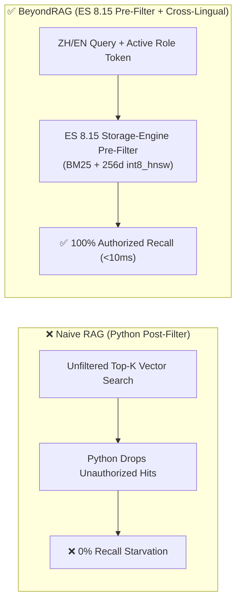

# BeyondRAG — Enterprise RBAC & Cross-Lingual RAG Sandbox

> **Series:** *Beyond a PoC* — Episode #01: **Access Management (RBAC) & Cross-Language Retrieval**

Most RAG tutorials stop at chunking a single PDF for a single user. When enterprises deploy a **company-wide shared knowledge base**, two production challenges immediately break naive RAG pipelines:

1. **Access Management (RBAC Pre-Filtering):** Documents uploaded by different departments carry role tags (`finance`, `operation`, or untagged `PUBLIC`). Filtering permissions in Python *after* running an unfiltered `top-K` vector search causes **0% recall starvation** whenever restricted chunks saturate the `top-K` HNSW candidate slots. `BeyondRAG` pushes `terms` pre-filters directly into **Elasticsearch 8.15** across both BM25 and `int8_hnsw` kNN.
2. **Cross-Language (`ZH ↔ EN`) Retrieval:** Enterprise policies are authored in **English**, while teams frequently query the knowledge base in **Chinese** (e.g., asking `「最低港元現金儲備緩衝是多少？」` against an English Treasury PDF). `BeyondRAG` aligns bilingual domain concepts into a shared 256-dim L2-normalized vector space while strictly enforcing RBAC boundaries.

---

## Architecture Comparison: Naive Post-Filtering vs. `BeyondRAG`



---

## Quickstart (Docker Compose Sandbox)

```bash
git clone https://github.com/metemertkan/BeyondRAG.git
cd BeyondRAG
docker compose up -d --build
```

Open **`http://localhost:8090`** in your browser:

1. **Left Panel (`1. PDF Upload & Knowledge Base`):**
   - Upload any `.pdf` file and assign role tags (`finance`, `operation`) or leave untagged (`PUBLIC`).
   - View all indexed PDFs in the knowledge base and their live `✓ Unlocked` / `🔒 Locked` state as you switch roles in the top bar.
2. **Right Panel (`2. Multi-Lingual RBAC Chat`):**
   - Click the pre-generated Chinese or English queries (`[Public 公開]`, `[Finance 財務標籤]`, `[Operation 營運標籤]`) while toggling between `Public Only`, `Finance Role`, `Operation Role`, and `All Roles`.

---

## Reproducing the RBAC Pre-Filter vs. Post-Filter Benchmark

Run the standalone Elasticsearch 8.15 benchmark inside the container:

```bash
docker compose exec beyondrag-app python benchmark_rbac.py
```

| Retrieval Strategy | Authorized Recall | P95 Latency | Behavior |
| :--- | :---: | :---: | :--- |
| **Query 1: Unfiltered Top-5 kNN + Python Post-Filter** | `0 / 2` (**0%**) | N/A | Restricted chunks fill all 5 HNSW slots; Python drops all 5 hits. |
| **Query 2: ES 8.15 Pre-Filtered Hybrid (`BM25 + int8_hnsw`)** | `2 / 2` (**100%**) | **`~3–7 ms`** | Pushes `terms: {"acl_tags": ["__public__", ...roles]}` into the storage engine. |

---

## Repository Structure

```text
BeyondRAG/
├── Dockerfile                # Python 3.12 container image for the FastAPI + RAG service
├── docker-compose.yml        # Elasticsearch 8.15 + BeyondRAG Web UI sandbox
├── pyproject.toml            # Python package & dependency definitions
├── web_server.py             # FastAPI Uvicorn entrypoint (port 8090)
├── benchmark_rbac.py         # Standalone ES 8.15 Pre-Filter vs Post-Filter benchmark
├── src/
│   ├── config.py             # Environment & Dual-LLM router (Gemini + Ollama fallback)
│   ├── rag/
│   │   ├── embeddings.py     # 256-dim Cross-Lingual (EN <-> ZH) Embedder
│   │   └── service.py        # ES 8.15 RBAC Pre-Filtered & Cross-Lingual RAG Service
│   └── web/
│       ├── app.py            # REST API endpoints (/api/upload, /api/documents, /api/chat)
│       └── static/
│           └── index.html    # 2-Section Web UI (PDF Upload & KB List + Multi-Lingual Chat)
└── workspace/
    └── uploads/              # Persistent storage for uploaded & seeded PDFs
```

---

## *Beyond a PoC* Series Roadmap

- [x] **Episode #01 (`BeyondRAG`):** Access Management (RBAC Pre-Filtering) & Cross-Language (`ZH ↔ EN`) Retrieval in Elasticsearch 8.15
- [ ] **Episode #02 (Up Next):** Deep Dive into Production Document Ingestion (Layout-Aware Parsing, Tables & Multi-Modal Chunking)
