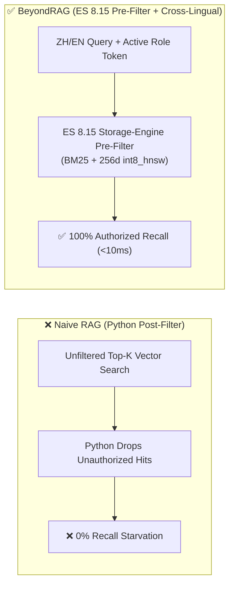

# BeyondRAG — Enterprise RBAC & Cross-Lingual RAG Sandbox

> **Series:** *Beyond a PoC* — Episode #01: **Access Management (RBAC) & Cross-Language Retrieval**

Most RAG tutorials stop at chunking a single PDF for a single user. When enterprises deploy a **company-wide shared knowledge base**, two production challenges immediately break naive RAG pipelines:

1. **Access Management (RBAC Pre-Filtering):** Documents uploaded by different departments carry role tags (`finance`, `operation`, or untagged `PUBLIC`). Filtering permissions in Python *after* running an unfiltered `top-K` vector search causes **0% recall starvation** whenever restricted chunks saturate the `top-K` HNSW candidate slots. `BeyondRAG` pushes `terms` pre-filters directly into **Elasticsearch 8.15** across both BM25 and `int8_hnsw` kNN.
2. **Cross-Language (`ZH ↔ EN`) Retrieval:** Enterprise policies are authored in **English**, while teams frequently query the knowledge base in **Chinese** (e.g., asking `「最低港元現金儲備緩衝是多少？」` against an English Treasury PDF). `BeyondRAG` aligns bilingual domain concepts into a shared 256-dim L2-normalized vector space while strictly enforcing RBAC boundaries.

---

## Architecture Comparison: Naive Post-Filtering vs. `BeyondRAG`



---

## Quickstart (Docker Compose Sandbox)

```bash
git clone https://github.com/metemertkan/BeyondRAG.git
cd BeyondRAG
docker compose up -d --build
```

Open **`http://localhost:8090`** in your browser:

1. **Left Panel (`1. PDF Upload & Knowledge Base`):**
   - Upload any `.pdf` file and assign role tags (`finance`, `operation`) or leave untagged (`PUBLIC`).
   - View all indexed PDFs in the knowledge base and their live `✓ Unlocked` / `🔒 Locked` state as you switch roles in the top bar.
2. **Right Panel (`2. Multi-Lingual RBAC Chat`):**
   - Click the pre-generated Chinese or English queries (`[Public 公開]`, `[Finance 財務標籤]`, `[Operation 營運標籤]`) while toggling between `Public Only`, `Finance Role`, `Operation Role`, and `All Roles`.

---

## Reproducing the RBAC Pre-Filter vs. Post-Filter Benchmark

Run the standalone Elasticsearch 8.15 benchmark inside the container:

```bash
docker compose exec beyondrag-app python benchmark_rbac.py
```

| Retrieval Strategy | Authorized Recall | P95 Latency | Behavior |
| :--- | :---: | :---: | :--- |
| **Query 1: Unfiltered Top-5 kNN + Python Post-Filter** | `0 / 2` (**0%**) | N/A | Restricted chunks fill all 5 HNSW slots; Python drops all 5 hits. |
| **Query 2: ES 8.15 Pre-Filtered Hybrid (`BM25 + int8_hnsw`)** | `2 / 2` (**100%**) | **`~3–7 ms`** | Pushes `terms: {"acl_tags": ["__public__", ...roles]}` into the storage engine. |

---

## Repository Structure

```text
BeyondRAG/
├── Dockerfile                # Python 3.12 container image for the FastAPI + RAG service
├── docker-compose.yml        # Elasticsearch 8.15 + BeyondRAG Web UI sandbox
├── pyproject.toml            # Python package & dependency definitions
├── web_server.py             # FastAPI Uvicorn entrypoint (port 8090)
├── benchmark_rbac.py         # Standalone ES 8.15 Pre-Filter vs Post-Filter benchmark
├── src/
│   ├── config.py             # Environment & Dual-LLM router (Gemini + Ollama fallback)
│   ├── rag/
│   │   ├── service.py        # Thin Domain Facade (delegates to injected ports; zero infra imports)
│   │   ├── models.py         # Pure Domain: IngestionState, DocumentChunk, Concept, IngestionReport
│   │   ├── ports.py          # Pure Domain: Protocol interfaces for decoupled hexagonal architecture
│   │   ├── acl.py            # 1. ACL Management & Role Hierarchy (AuthorizationPolicy, expansion)
│   │   ├── chunker.py        # 2. Chunking (Sliding window, paragraph, sentence, recursive, semantic & adaptive)
│   │   ├── ingestor.py       # 3. Document Ingestion (Idempotent lifecycle, rollback, deterministic IDs)
│   │   ├── es_client.py      # 4. ES Connection & Index Management (int8_hnsw + slowlog lifecycle)
│   │   ├── extractor.py      # 5. Pluggable Document Parsers (PyPDF, PlainText / Markdown registry)
│   │   ├── embeddings.py     # 6. Embedding Providers & Manifests (FeatureHash, Ollama, Google, Fake)
│   │   ├── repository.py     # 7. Document Persistence (Bulk indexing, atomic replacement, uploads)
│   │   ├── profiles.py       # 8. Retrieval Profiles & Tenants (precision, high_recall, executive_summary)
│   │   ├── retriever.py      # 9. Hybrid Retrieval (ES 8.15 Pre-Filtered BM25 + int8_hnsw & mask audit)
│   │   ├── cross_lingual.py  # 10. Multilingual Query Handling (Rule-based detector, query translator)
│   │   ├── synthesizer.py    # 11. Answer Synthesis (grounded citations & RBAC block notices)
│   │   ├── seeding.py        # 12. Demo Document Seeding (ReportLab PDF generation & sample seeding)
│   │   ├── multilingual.py   # 13. Script handling (RTL repair, normalization, tokenization, sentences)
│   │   ├── ocr.py            # 14. OCR port & PaddleOCR adapter for scanned pages
│   │   ├── tabular_store.py  # 15. SQLite store + structured table queries for large sheets
│   │   ├── governance.py     # 16. Trust tiers, expiry, source precedence, conflict detection
│   │   └── erasure.py        # 17. Lineage-based hard deletion, tombstones, source-system sync
│   ├── eval/                 # Golden-dataset harness and LLM-as-a-judge metrics
│   └── web/
│       ├── app.py            # REST API endpoints (/api/upload, /api/documents, /api/chat)
│       └── static/
│           └── index.html    # 2-Section Web UI (PDF Upload & KB List + Multi-Lingual Chat)
├── tests/                    # Unit, acceptance and live-Elasticsearch tests
├── eval/                     # Golden dataset, thresholds and evaluation corpus
├── .github/workflows/        # rag-eval.yml: manual LLM-as-a-judge gate on a self-hosted runner
└── workspace/
    ├── dynamic_concepts.json # Persisted concept mappings
    └── uploads/              # Persistent storage for uploaded & seeded PDFs
```

---

## Configuration & Environment Variables

| Variable | Default | Description |
| :--- | :--- | :--- |
| `RAG_EMBEDDING_PROVIDER` | `feature_hash` | Active embedding provider: `feature_hash`, `ollama`, `remote_api`, `google`, or `fake`. **Forwarded into the app container** by `docker-compose.yml` (`${RAG_EMBEDDING_PROVIDER:-feature_hash}`). Copy `.env.example` → `.env` so Compose interpolates host values. |
| `RAG_EMBEDDING_DIMS` | `256` | Vector dimensions for Elasticsearch dense_vector indexing. Forwarded by Compose. |
| `RAG_EMBEDDING_MODEL` | `bge-m3` | Embedding model when using `ollama`, `remote_api`, or `google`. Forwarded by Compose. |
| `RAG_EMBEDDING_API_KEY` | _(empty)_ | API key for `remote_api` (OpenAI-compatible). Alias: `OPENAI_API_KEY`. Forwarded by Compose. |
| `RAG_EMBEDDING_API_BASE` | `https://api.openai.com/v1` | Base URL for `remote_api` embeddings. Forwarded by Compose. |
| `RAG_CHUNKING_STRATEGY` | `sliding_window` (Compose: `adaptive`) | Active chunking algorithm: `sliding_window`, `paragraph`, `sentence`, `recursive`, `semantic`, `adaptive`. |
| `RAG_CHUNK_MAX_TOKENS` | `500` | Maximum token/character limit per chunk. |
| `RAG_CHUNK_OVERLAP_TOKENS`| `80` | Overlap budget between consecutive chunks. |
| `RAG_INDEX_PREFIX` | `hk-rbac-rag-kb` | Elasticsearch index name or prefix. |
| `RAG_TENANT_MODE` | `shared` | Multi-tenancy mode: `shared` or `per_tenant`. |
| `RAG_BASELINE_ROLES` | `finance,operation` | Default enterprise baseline roles. |
| `RAG_CORPUS_LANGUAGE` | `en` | Primary language of the document corpus. |
| `RAG_XLSX_INLINE_ROWS` | `40` | Sheets over this many rows become one summary chunk plus a SQLite table. |
| `RAG_XLSX_LLM_SUMMARY` | `false` | Adds an LLM-written purpose sentence to each large-table summary at ingestion. |
| `RAG_OCR_LANGS` | _(empty)_ | PaddleOCR language codes for scanned pages, e.g. `ar,ch,en`. Requires `pip install .[ocr]`. |
| `RAG_GOVERNANCE_TOKEN` | _(empty)_ | Enables `/api/erasure` and `/api/sync/events`. Both return 503 while this is unset. |
| `RAG_ERASURE_KEY` | _(generated)_ | Key for hashed identifiers in the audit log. Generated under `workspace/` when empty. |

---

## Running Automated Tests

```bash
# Tests that need Elasticsearch skip themselves when no cluster is reachable
pytest tests/ -q
```

---

## Episode 2 — Production Document Ingestion

Getting a clean demo out of a RAG pipeline is easy. Keeping it correct when the data is messy, changing and legally constrained is the hard part. Episode 2 covers six challenges, each implemented here and tested in [`tests/test_ingestion_challenges.py`](./tests/test_ingestion_challenges.py).

| Challenge | Failure without it | What the code does | Where |
| --- | --- | --- | --- |
| **Complex formats** | Flat ETL loses table structure, formula results and merged cells | PDF tables and Excel become Markdown tables; merged cells fill every row; formulas index their calculated result; cross-sheet references get a lineage note; hidden sheets are skipped; large sheets become one summary chunk plus a SQLite table queried by a structured tool call | `extractor.py`, `tabular_store.py` |
| **Multilingual** | Reversed Arabic, oversized Chinese chunks, zero-information vectors | RTL reading-order repair, tashkeel and presentation-form normalization, jieba segmentation, script-aware sentence splitting, an ES analyzer with Arabic normalization and Han bigrams, a PaddleOCR adapter for scanned pages, `bge-m3` as the shared embedding space | `multilingual.py`, `ocr.py`, `es_client.py` |
| **Semantic chunking** | Fixed windows cut across topics; pure semantic chunking is slow and fragments long sections | Topic boundaries from sentence-embedding similarity, 15% sliding overlap, minimum and maximum chunk size, and a router that sends uniform documents to cheap fixed-size chunking | `chunker.py` |
| **Versioning and ground-truth decay** | Old and new facts compete; the LLM blends them | Soft `SUPERSEDED` versions, expiry dates, trust tiers that re-rank results, numeric conflict detection, and a precedence prompt that makes the model declare contradictions | `ingestor.py`, `governance.py`, `retriever.py`, `synthesizer.py` |
| **GDPR and deletions** | Deleting a file leaves chunks, old versions, vectors, tables and derived concepts behind | `source_key` and `subject_ids` lineage on every chunk, dry-run plans, purge of every store, re-scan verification, tombstones against re-sync resurrection, keyed-hash audit log, source-system delete and archive events | `erasure.py`, `repository.py` |
| **Continuous evaluation** | Retrieval quality degrades silently | A golden dataset, run on demand and scored by a local LLM judge on Context Precision and Faithfulness, plus deterministic checks that retired facts stay out of the context | `src/eval/`, `.github/workflows/rag-eval.yml` |

### Try it

```bash
docker compose up -d --build
pytest tests/ -q

# Upload with governance and lineage metadata
curl -F file=@tests/fixtures/xlsx/regional_budget.xlsx -F tags=finance \
     -F trust_tier=official_policy -F effective_date=2026-01-05 \
     http://localhost:8090/api/upload

# Right-to-be-forgotten: dry run by default. Requires RAG_GOVERNANCE_TOKEN in .env.
curl -X POST http://localhost:8090/api/erasure \
     -H "X-Governance-Token: $RAG_GOVERNANCE_TOKEN" -H "Content-Type: application/json" \
     -d '{"subject_id": "maya.chen@example.com"}'
```

Regenerate the measurements behind the episode visuals with `python scripts/ep2_showcase.py --out showcase.json`.

### Continuous evaluation

This is a demonstration gate: the judge is local Ollama (`qwen3:8b`), which can misjudge an answer and is slow on CPU. The floors live in [`eval/golden_dataset.json`](./eval/golden_dataset.json).

```bash
python scripts/run_eval.py                               # exit 0 passed, 1 gate failed, 2 inconclusive
python scripts/run_eval.py --simulate-drift stale_index  # see the gate catch a regression
RAG_EVAL_OLLAMA_MODEL=<installed model> python scripts/run_eval.py  # use a different judge
```

An unavailable judge or missing model exits 2, because a gate that passes without evaluating anything is worse than no gate.

[`.github/workflows/rag-eval.yml`](./.github/workflows/rag-eval.yml) runs the same gate when started by hand from `main`. It needs a self-hosted runner on a machine with uv, Ollama and Elasticsearch, and does not run on merges, so it cannot block a regression. To block merges, also trigger it on `pull_request` and mark the check as required, after reviewing the risk of self-hosted runners on a public repository.

### Limits worth knowing

- **Deletion is two-phase.** Search stops returning erased data immediately, but Elasticsearch keeps deleted text in its segments under a retention lease, so a force-merge straight after the delete removes nothing. `confirm_physical_purge` retries and writes the outcome to the audit log. On the single-node sandbox this takes about 30 seconds; replicas can hold a lease for longer.
- **Backups are out of scope.** Snapshots keep erased data until they expire under their own retention window. Every receipt says so.
- **Subject detection finds emails only.** Names and employee IDs must be declared through `subject_ids`. Verification also runs a full-text scan for the identifier, which catches mentions that lineage missed.
- **Keeping a document that names someone** (`include_detected: false`) produces an incomplete receipt until that file is redacted or removed.
- **Conflict detection is a numeric heuristic.** It compares values such as amounts and durations across sources on the same topic. Contradictions in wording alone rely on the LLM prompt rules.
- **OCR is per page and per language.** PaddleOCR's Arabic recognizer read our test scan's Arabic text and numbers correctly but turned `HKD` into `H`. Mixed-script scans still need review; see `tests/fixtures/README.md`. It is an optional install: `pip install .[ocr]`.
- **`feature_hash` is not semantic.** It keeps CI deterministic. Use `RAG_EMBEDDING_PROVIDER=ollama` with `bge-m3` (`RAG_EMBEDDING_DIMS=1024`) for cross-language retrieval and meaningful topic boundaries.
- **The judge is a model too.** In a local run, `qwen3:8b` scored one correct answer 0.40 on faithfulness because it listed claims from a source instead of from the answer. That is why the gate uses averages over a dataset and keeps deterministic checks beside the judged scores. A larger golden set and a stronger judge reduce this noise.
- **Averages can hide one wrong answer.** In the simulated `stale_index` run, the judged averages stayed above their floors while one answer was wrong. The deterministic retired-fact check is what failed the run.
- **The governance API token is the only auth added here.** The sandbox's chat and upload endpoints still trust client-supplied roles, as they did in Episode 1. Put real authentication in front of them in production.

### Parser trade-offs

| Option | Why / why not |
| --- | --- |
| **pdfplumber (primary)** | MIT, table and layout extraction, modest image size, works offline |
| **PyPDF (fallback)** | Tiny; keeps Docker boot working if pdfplumber is unavailable; flattens tables |
| **openpyxl (Excel)** | Reads formulas and cached results separately, and exposes merged ranges |
| **PaddleOCR (optional)** | Ships Arabic and Chinese recognizers; about 1 GB of dependencies, so opt-in |
| Docling | Strong fidelity but heavier ML and image dependencies; deferred for sandbox size |
| PyMuPDF | Capable and fast; AGPL licensing friction for some deployments; deferred |

---

## *Beyond a PoC* Series Roadmap

- [x] **Episode #01 (`BeyondRAG`):** Access Management (RBAC Pre-Filtering) & Dynamic LLM Cross-Language (`ZH ↔ EN`) Retrieval in Elasticsearch 8.15
- [x] **Episode #02:** Production document ingestion: complex formats, multilingual processing, semantic chunking, versioning and ground-truth decay, GDPR deletion, continuous evaluation
